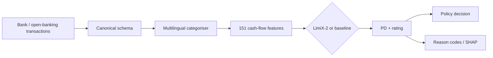

# OpenCashFlow

**Cash-flow underwriting for B2B / SME credit risk, built in the open.**

OpenCashFlow turns raw open-banking-style transactions into credit-relevant features, a probability
of default (PD), an illustrative policy decision and human-readable reason codes. It uses
**LimiX-2** as the primary tabular foundation model, with LightGBM, XGBoost, logistic regression and
an untrained cash-flow scorecard as baselines.

The project is an original, Apache-2.0 alternative to closed cash-flow underwriting products. It is
designed for researchers, fintech engineers and credit-risk teams who need a transparent baseline
they can inspect, extend and benchmark.



## Why this exists

SME credit tooling is dominated by closed products, and public SME datasets are mostly accounting
ratios rather than bank ledgers. That makes it hard to evaluate the part that matters most for
cash-flow lending: turning transaction behaviour into a defensible risk signal.

OpenCashFlow provides:

* a transparent, rule-first transaction categoriser for European bank narratives;
* 151 documented cash-flow features with safe arithmetic and point-in-time scoring when `as_of` is passed;
* a LimiX-2 wrapper for classification, regression and imputation, including CPU/Windows support;
* tree, linear and heuristic baselines with SHAP and model-agnostic explanations;
* an end-to-end pipeline with ratings, policy decisions and reason codes;
* public dataset loaders with attribution, plus a documented synthetic portfolio generator;
* tests, notebooks and a reproducible benchmark suite.

## Benchmark snapshot

Stratified 3-fold cross-validation with seed 42 and 2 repeats, so each model has 6 runs. The table
shows mean ROC-AUC. The 95% interval is the mean plus or minus t(0.975, n-1) times the standard
deviation over the square root of the number of runs. The interval is approximate and understates
uncertainty because the folds share training rows. LimiX-2 uses one ensemble pipeline on CPU. The
Bangladesh leakage column is dropped. German and Polish are tabular accounting or application
datasets, not transaction ledgers; the synthetic portfolio exercises the full transaction pipeline.

| Dataset | Rows | LimiX-2 ROC-AUC | XGBoost ROC-AUC | LightGBM ROC-AUC | Logistic ROC-AUC | Heuristic ROC-AUC |
|---|---:|---:|---:|---:|---:|---:|
| Bangladesh SME | 1,200 | 0.932 [0.912, 0.953] | 0.898 [0.883, 0.913] | 0.896 [0.877, 0.916] | 0.847 [0.838, 0.856] | n/a |
| German Credit | 1,000 | 0.802 [0.775, 0.829] | 0.779 [0.749, 0.809] | 0.766 [0.741, 0.791] | 0.773 [0.752, 0.794] | n/a |
| Polish 1-year | 7,027 | 0.975 [0.968, 0.982] | 0.954 [0.944, 0.965] | 0.952 [0.941, 0.963] | 0.811 [0.801, 0.821] | n/a |
| Synthetic portfolio | 300 | 0.886 [0.805, 0.966] | 0.862 [0.780, 0.945] | 0.857 [0.778, 0.935] | 0.824 [0.774, 0.875] | 0.887 [0.848, 0.925] |

Among the trained models, LimiX-2 has the highest mean ROC-AUC on all four datasets above. On the
synthetic data it is level with the untrained heuristic. Its interval overlaps the next model's on
German, on synthetic and on Bangladesh (by 0.001). It is clearly separated on Polish. The heuristic
scorecard is only defined for cash-flow features, so it is not run on the tabular datasets.

Brier score: LimiX-2 is lowest on Bangladesh (0.089), German (0.160) and synthetic (0.048). On
Polish the tree models are slightly lower (LightGBM and XGBoost 0.016; LimiX-2 0.017).

> **Evaluate on a holdout.** Calling `predict` on the same transactions used in `fit` is in-sample
> and will overstate performance, especially for LimiX's in-context learning. Split by borrower,
> not by transaction, and keep the test borrowers out of the reference set.

> **LimiX-2 licence:** the weights are non-commercial. The code here is Apache-2.0, but commercial
> use of the model requires a separate agreement with Stable AI. See [LimiX integration](docs/limix.md).

### SBA National loan data

The loaded file has 897,167 labelled loans after dropping 1,997 rows with no status; 17.6% charged
off. The tables below use random 3-fold cross-validation on a 5,000-row stratified sample (21
features, 6 runs), out-of-time splits on a 20,000-row sample, and a matured bound. Intervals are
shown where they were reported.

| Setting | LimiX-2 ROC-AUC | XGBoost ROC-AUC | LightGBM ROC-AUC | Logistic ROC-AUC |
|---|---:|---:|---:|---:|
| Random CV, 21 features | 0.976 [0.971, 0.981] | 0.960 [0.950, 0.969] | 0.958 [0.948, 0.969] | 0.854 [0.843, 0.864] |
| Random CV, no term (19 features) | 0.823 [0.808, 0.839] | 0.802 [0.788, 0.816] | 0.799 [0.784, 0.815] | 0.734 [0.717, 0.751] |
| Out-of-time, 21 features | n/a | 0.947 | 0.948 | 0.784 |
| Out-of-time, no term | n/a | 0.620 | 0.631 | 0.586 |
| Matured bound, 2004 to 2008 test | n/a | 0.957 | 0.957 | 0.803 |
| Matured bound, no term | n/a | 0.631 | 0.639 | 0.581 |

The out-of-time split trains on approval_fy up to 2003 (11,401 rows) and tests on approval_fy after
2003 (8,599 rows). The matured bound trains on 12,206 rows and tests on 7,794 rows with approvals
in 2004 to 2008. Most random-CV performance depends on Term. Out of time without Term, AUC is about
0.6. The matured bound changes little. Term has not been verified as known at approval, so these
results are not approval-time PD. LimiX was not run out of time because it is too slow at this
sample size. See [`benchmarks/results/sba`](benchmarks/results/sba) for the saved run.

Read all of these tables as an internal, reproducible comparison, not a leaderboard. AUC hides
calibration; the saved results also include KS, PR-AUC, Brier score and log loss.

## Install

Python 3.10+ is required.

```bash
git clone https://github.com/youssbm/opencashflow
cd opencashflow
python -m venv .venv
# Windows: .venv\Scripts\Activate.ps1
# macOS/Linux: source .venv/bin/activate
python -m pip install -e ".[trees,dev]"
```

Core install without tree models or notebooks:

```bash
python -m pip install -e .
```

LimiX-2 is installed separately from source and weights:

```bash
git clone https://github.com/limix-ldm-ai/LimiX
cd LimiX && git checkout a917fa0 && pip install -e .
export LIMIX_MODEL_PATH=/path/to/LimiX-2-1016.ckpt
export LIMIX_SRC=/path/to/LimiX
```

On Windows CPU, the wrapper installs a no-op triton shim automatically. See
[docs/limix.md](docs/limix.md) for pinned versions and troubleshooting.

## Quickstart

```python
from opencashflow.data.synthetic import generate_portfolio
from opencashflow.features.cashflow_features import FeatureConfig
from opencashflow.pipeline import CashFlowPipeline

portfolio = generate_portfolio(n_companies=120, months=20, seed=42)
config = FeatureConfig(as_of=portfolio.metadata["observation_end"])
pipeline = CashFlowPipeline(config=config, scorer="lightgbm")
pipeline.fit(portfolio.transactions, portfolio.labels)
scored = pipeline.predict(portfolio.transactions, top_k=3, ead=25_000)
print(scored[["pd", "rating", "decision", "reason_1"]].head())
print(pipeline.portfolio_summary(scored))
```

The `as_of` value passed through `FeatureConfig` is the point-in-time cut-off. Without it, features
use each company's latest transaction date and a warning is raised.

The examples below reuse `config` from the block above, so they all pass `as_of`.

No labels or no model? Use the untrained scorecard:

```python
pipeline = CashFlowPipeline(config=config, scorer="heuristic").fit(portfolio.transactions)
scored = pipeline.predict(portfolio.transactions, explain=False)
```

Use LimiX-2 (requires the checkpoint and source described in [docs/limix.md](docs/limix.md)):

```python
pipeline = CashFlowPipeline(config=config, scorer="limix")
pipeline.fit(portfolio.transactions, portfolio.labels)
scored = pipeline.predict(portfolio.transactions, top_k=3)
```

Or from the command line:

```bash
opencashflow demo --companies 80 --scorer heuristic
opencashflow download polish german bangladesh_sme
opencashflow benchmark --datasets german --models logistic,lightgbm
```

If the `opencashflow` entry point is not on your PATH after an editable install, use
`python -m opencashflow.cli` with the same arguments.

## Feature engine

`CashFlowFeatureExtractor` computes one row per borrower over a configurable window. Every feature is
declared in `opencashflow/features/specs.py`, so code and documentation cannot drift.

| Group | Features | Examples |
|---|---:|---|
| Coverage | 12 | transaction count, months observed, coverage, uncategorised share, balance availability |
| Revenue | 24 | level, growth, momentum, volatility, seasonality, customer HHI, top-customer share |
| Expenses | 32 | payroll, rent, supplier, tax, VAT, fixed-cost ratio, discretionary share |
| Liquidity | 30 | balances, runway, days cash, overdraft days, net cash flow, burn rate, buffer |
| Debt | 12 | debt service, DSCR, interest coverage, loan proceeds, net debt flow |
| Distress | 16 | NSF, returned payments, fees, gambling, cash withdrawals, overdraft events |
| Behaviour | 11 | payroll day consistency, dormant gaps, recurring counterparties, transaction frequency |
| Trends | 9 | inflow/outflow/net growth, slopes, seasonality, revenue-expense correlation |
| Composite | 5 | stability, liquidity, leverage, distress and overall health scores |
| **Total** | **151** | |

```python
from opencashflow.features.cashflow_features import CashFlowFeatureExtractor, FeatureConfig

extractor = CashFlowFeatureExtractor(
    config=FeatureConfig(window_days=365, as_of="2024-03-31")
)
features = extractor.fit_transform(transactions)
print(features.shape)  # (n_entities, 151)
```

The full dictionary is in [docs/features.md](docs/features.md), generated by
`scripts/generate_feature_docs.py`. Do not edit that file by hand.

### Transaction categorisation

The default engine is a priority-ordered, direction-aware rule set covering SEPA-style narratives in
English, German, French, Polish, Italian, Dutch and Spanish. A character n-gram classifier can be
trained as a fallback. Every prediction carries the category, confidence, method and matched rule.

```python
from opencashflow.features.categorizer import TransactionCategorizer

categorizer = TransactionCategorizer()
labelled = categorizer.categorize_frame(transactions)
print(categorizer.category_summary(labelled))
```

## Datasets

| Key | Dataset | Rows | Licence | Source |
|---|---|---:|---|---|
| `polish` | Polish Companies Bankruptcy | 7,027 | CC BY 4.0 | [UCI 365](https://archive.ics.uci.edu/dataset/365/polish+companies+bankruptcy+data), DOI 10.24432/C5F600 |
| `german` | Statlog German Credit | 1,000 | CC BY 4.0 | [UCI 144](https://archive.ics.uci.edu/dataset/144/statlog+german+credit+data), DOI 10.24432/C5NC77 |
| `bangladesh_sme` | Bangladesh SME Credit | 1,200 | CC BY 4.0 data, MIT code | [Zenodo 18525278](https://zenodo.org/records/18525278), DOI 10.5281/zenodo.18525278 |
| `sba` | SBA National Loan Data | 897,167 | CC BY-SA 4.0 | [Kaggle](https://www.kaggle.com/datasets/mirbektoktogaraev/should-this-loan-be-approved-or-denied) |
| `synthetic` | OpenCashFlow synthetic portfolio | configurable | Apache-2.0 | generated locally |

```bash
python data/download.py --dataset all
```

```python
from opencashflow.data.loaders import load_dataset

bundle = load_dataset("bangladesh_sme")
print(bundle.summary())
print(bundle.X.shape, bundle.y.mean())
```

**Leakage note:** the Bangladesh dataset contains `missed_payment_last_12m`, an exact restatement of
the target. The loader drops it by default. Keeping it leaks the target directly. See
[docs/datasets.md](docs/datasets.md).

**SBA note:** the SBA National dataset is U.S. government-guaranteed lending, not European
open-banking data. The loader keeps 21 features and excludes five post-approval columns:
`ChgOffDate`, `DisbursementDate`, `DisbursementGross`, `BalanceGross` and `ChgOffPrinGr`. The Kaggle
upload is CC BY-SA 4.0, so derived datasets may carry share-alike obligations. For CPU LimiX, use a
stratified cap:

```python
sba = load_dataset("sba", max_rows=20_000, random_state=42)
```

**German note:** `personal_status_sex`, `age_years` and `foreign_worker` can act as proxies for sex,
age and nationality. `exclude_protected=True` drops them. Review before any lending use.

The synthetic generator produces localised ledgers for European countries with customer receipts,
payroll, rent, supplier invoices, tax, debt service, card spend and distress events. The label is a
12-month forward outcome. A latent stress variable drives both the ledger and the default
probability, and stress is not a feature. At the published configuration (300 companies, 20 months,
seed 42) the realised default rate is 11.3%. The untrained heuristic is not an independent baseline
on this data because its risk drivers overlap with the label's. See
[docs/datasets.md](docs/datasets.md) for the generator details.

## Models and explanations

```python
from opencashflow.models import evaluate_binary, explain_model, make_baseline

model = make_baseline("lightgbm").fit(X_train, y_train)
metrics = evaluate_binary(y_test, model.predict_pd(X_test))
print(metrics["roc_auc"], metrics["ks"], metrics["brier"])

explanation = explain_model(model, X_test.head(1))[0]
print(explanation.reason_codes(3))
```

* `LimiXScorer` - in-context classification, regression and imputation.
* `TreeBaseline` - LightGBM or XGBoost with categorical encoding.
* `LogisticBaseline` - median imputation, quantile transform by default (or standard scaler), one-hot encoding, L2.
* `HeuristicScorer` - fixed, explainable cash-flow scorecard.
* `ShapExplainer` - exact TreeSHAP for tree models.
* `OcclusionExplainer` - model-agnostic PD changes for LimiX and logistic models.
* `AdditiveExplainer` - contributions for the heuristic scorecard.
* `evaluate_binary` - AUC, KS, Gini, PR-AUC, Brier, log loss, confusion counts.
* `calibration_table`, `rating_from_pd`, `expected_loss`, `cost_sensitive_threshold`.

The SHAP package in the current environment prints one notice when explaining LightGBM models:
"LightGBM binary classifier with TreeExplainer shap values output has changed to a list of ndarray".
It does not change the results. Reason codes list only risk-increasing features, largest first.
They are illustrative adverse-action style statements, not regulated reason codes.

### Calibration

No calibration step is shipped. Probabilities are raw model outputs. The benchmark reports Brier
score and log loss; `calibration_table` helps inspect them. Calibrated PDs are on the roadmap.

## Project structure

```
opencashflow/
├── opencashflow/
│   ├── features/        # ratio helpers, categoriser, 151 features, feature catalogue
│   ├── models/          # LimiX wrapper, baselines, metrics, explanations
│   ├── data/            # schema, synthetic generator, loaders, macro joiner, downloader
│   ├── pipeline.py      # end-to-end underwriting and persistence
│   ├── benchmark.py     # cross-validated benchmark harness
│   └── cli.py           # `opencashflow` command line
├── tests/               # fast suite, plus opt-in LimiX tests
├── notebooks/           # feature engineering, LimiX scoring, benchmarks
├── benchmarks/          # benchmark CLI and saved results
├── docs/                # feature dictionary, datasets, LimiX, architecture, examples
├── data/                # download script and raw-data landing zone
└── examples/            # runnable scripts
```

## Testing

On a clean checkout the fast suite passes 343 tests and skips 9: five LimiX integration tests,
which need `OPENCASHFLOW_RUN_LIMIX=1` and the checkpoint and source, and four tests that need the
datasets downloaded into `data/raw`. With the datasets in place, 347 tests pass.

```bash
python -m pytest -q
python -m ruff check opencashflow tests benchmarks
```

LimiX integration tests load the checkpoint:

```bash
export OPENCASHFLOW_RUN_LIMIX=1
python -m pytest tests/test_limix.py -q -m limix
```

Verified locally on Python 3.13 only. The CI matrix covers Python 3.10 to 3.13; the 3.10 to 3.12
runs have not been done locally.

## Benchmark

Published main configuration:

```bash
python benchmarks/run_benchmark.py --datasets synthetic,german,bangladesh_sme,polish \
  --models heuristic,logistic,lightgbm,xgboost,limix --cv 3 --repeats 2 \
  --synthetic-companies 300 --synthetic-months 20 --limix-pipelines 1 \
  --output-dir benchmarks/results
```

Published SBA configuration:

```bash
python benchmarks/run_benchmark.py --datasets sba --models logistic,lightgbm,xgboost,limix \
  --cv 3 --repeats 2 --max-rows 5000 --limix-pipelines 1 \
  --output-dir benchmarks/results/sba
```

Without `--output-dir` the script prints results and writes nothing. Saved results are in
[benchmarks/results](benchmarks/results). The benchmark:

* uses stratified K-fold with `cv=3` and `repeats=2` for the published tables, so each model has 6
  runs; repeat i reshuffles the folds with seed + i - 1;
* uses the same folds for every model, fits preprocessing inside each training fold, and gives
  LimiX only the training fold as its in-context reference set (one ensemble pipeline on CPU);
* reports the interval as the mean plus or minus t(0.975, n-1) times the standard deviation over the
  square root of the number of runs, and notes that folds share training rows, so the interval is
  approximate;
* runs the out-of-time split once with no repeats, training on approval_fy up to the cutoff and
  testing on approval_fy after it, without LimiX;
* reports AUC, KS, PR-AUC, Brier score and log loss, not just a headline AUC. `predict_seconds` is
  measured per fold.

## Design principles

* **Auditable over clever.** Rules and feature definitions are explicit and versioned.
* **Point-in-time when configured.** Features are point-in-time only when `as_of` is passed. Without
  it, features use each entity's latest transaction date and a warning is raised.
* **No silent NaNs.** Safe division, finite-value checks and clipping.
* **Honest about limitations.** Small public samples, accounting-ratio datasets, non-commercial
  weights and model-relative explanations are all documented.
* **Optional heavy dependencies.** The package imports without LimiX, XGBoost or SHAP installed.

## Roadmap

* Calibrated PDs with isotonic/Platt scaling and segment-level calibration.
* More European bank narrative packs and merchant normalisation.
* Point-in-time macro vintages for Eurostat and EBA series.
* Fairness and disparate-impact diagnostics for SME segments.
* Additional public SME datasets and a community benchmark leaderboard.
* Open-banking API adapters (PSD2 AIS) behind a stable data contract.

## Contributing

Contributions are welcome. Read [CONTRIBUTING.md](CONTRIBUTING.md) and
[AGENTS.md](AGENTS.md) first. Good first issues include new country narrative rules, additional
feature specs with tests, notebook improvements and dataset provenance checks.

## Project owner

OpenCashFlow is owned by **Youssef Ben Mahmoud** ([@youssbm](https://github.com/youssbm)). The
owner is requested as a reviewer on every pull request (see [`.github/CODEOWNERS`](.github/CODEOWNERS)).

## Citation

```bibtex
@software{opencashflow2026,
  title  = {OpenCashFlow: Cash-flow underwriting for SME credit risk},
  author = {Ben Mahmoud, Youssef and {OpenCashFlow contributors}},
  year   = {2026},
  url    = {https://github.com/youssbm/opencashflow},
  note   = {Apache-2.0 code; LimiX-2 weights are non-commercial}
}
```

If you use LimiX-2, cite Stable AI's model card and disclose the checkpoint and code commits. If you
use a public dataset, cite it as listed in [docs/datasets.md](docs/datasets.md).

Datasets to cite:

* The SBA Kaggle upload by Mirbek Toktogaraev, built from U.S. Small Business Administration data,
  licensed CC BY-SA 4.0.
* Min Li, Amy Mickel and Stanley Taylor (2018), "Should This Loan be Approved or Denied?: A Large
  Dataset with Class Assignment Guidelines", Journal of Statistics Education 26(1), pages 55 to 66,
  doi 10.1080/10691898.2018.1434342. These details come from search listings, not the full text.

## Licence

Code: [Apache-2.0](LICENSE). Datasets: their respective licences (CC BY 4.0 for UCI and Zenodo
data). **LimiX-2 weights: StableAI LimiX Non-Commercial License v1.0.** Commercial use of the
weights requires a separate agreement. This repository does not redistribute the weights.
