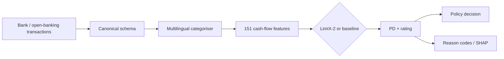

# OpenCashFlow

**Cash-flow underwriting for B2B / SME credit risk, built in the open.**

OpenCashFlow turns raw open-banking-style transactions into credit-relevant features, a probability
of default (PD), an illustrative policy decision and human-readable reason codes. It uses
**LimiX-2** as the primary tabular foundation model, with LightGBM, XGBoost, logistic regression and
an untrained cash-flow scorecard as baselines.

The project is an original, Apache-2.0 alternative to closed cash-flow underwriting products. It is
designed for researchers, fintech engineers and credit-risk teams who need a transparent baseline
they can inspect, extend and benchmark.



## Why this exists

SME credit tooling is dominated by closed products, and public SME datasets are mostly accounting
ratios rather than bank ledgers. That makes it hard to evaluate the part that matters most for
cash-flow lending: turning transaction behaviour into a defensible risk signal.

OpenCashFlow provides:

* a transparent, rule-first transaction categoriser for European bank narratives;
* 151 documented cash-flow features with safe arithmetic and point-in-time scoring;
* a LimiX-2 wrapper for classification, regression and imputation, including CPU/Windows support;
* tree, linear and heuristic baselines with SHAP and model-agnostic explanations;
* an end-to-end pipeline with ratings, policy decisions and reason codes;
* public dataset loaders with attribution, plus a documented synthetic portfolio generator;
* tests, notebooks and a reproducible benchmark suite.

## Benchmark snapshot

Stratified 3-fold cross-validation, seed 42. LimiX-2 uses **one ensemble pipeline on CPU** for
reproducibility. The Bangladesh leakage column is dropped. German and Polish are tabular accounting
or application datasets, not transaction ledgers; the synthetic portfolio exercises the full
transaction pipeline.

| Dataset | Rows | LimiX-2 AUC | LightGBM AUC | XGBoost AUC | Logistic AUC | Heuristic AUC |
|---|---:|---:|---:|---:|---:|---:|
| Synthetic SME portfolio | 300 | **0.857** | **0.857** | 0.842 | 0.783 | 0.853 |
| German Credit | 1,000 | **0.804** | 0.769 | 0.781 | 0.779 | n/a |
| Bangladesh SME | 1,200 | **0.928** | 0.894 | 0.893 | 0.895 | n/a |
| SBA National (5k sample) | 5,000 | **0.976** | 0.957 | 0.959 | 0.837 | n/a |
| Polish Bankruptcy (1year) | 7,027 | **0.975** | 0.946 | 0.958 | 0.730 | n/a |

LimiX-2 is best or tied on all five datasets under this protocol. On the synthetic transaction
benchmark it ties LightGBM, which is a useful reminder that foundation models are not automatically
better on every sample.

The SBA row uses a stratified 5,000-row sample because a 20k-row LimiX in-context run is too slow on
CPU. The loader supports the full 899,164 rows for tree models. See
[`benchmarks/results/sba`](benchmarks/results/sba) for the saved run.

Read these as an internal, reproducible comparison, not a leaderboard. AUC hides calibration; the
saved results include KS, PR-AUC, Brier score and log loss. The heuristic scorecard is only defined
for cash-flow features, so it is not run on the tabular datasets.

> **Evaluate on a holdout.** Calling `predict` on the same transactions used in `fit` is in-sample
> and will overstate performance, especially for LimiX's in-context learning. Split by borrower,
> not by transaction, and keep the test borrowers out of the reference set.

> **LimiX-2 licence:** the weights are non-commercial. The code here is Apache-2.0, but commercial
> use of the model requires a separate agreement with Stable AI. See [LimiX integration](docs/limix.md).

## Install

Python 3.10+ is required.

```bash
git clone https://github.com/opencashflow/opencashflow.git
cd opencashflow
python -m venv .venv
# Windows: .venv\Scripts\Activate.ps1
# macOS/Linux: source .venv/bin/activate
python -m pip install -e ".[trees,dev]"
```

Core install without tree models or notebooks:

```bash
python -m pip install -e .
```

LimiX-2 is installed separately from source and weights:

```bash
git clone https://github.com/limix-ldm-ai/LimiX
cd LimiX && git checkout a917fa0 && pip install -e .
export LIMIX_MODEL_PATH=/path/to/LimiX-2-1016.ckpt
export LIMIX_SRC=/path/to/LimiX
```

On Windows CPU, the wrapper installs a no-op triton shim automatically. See
[docs/limix.md](docs/limix.md) for pinned versions and troubleshooting.

## Quickstart

```python
from opencashflow.data.synthetic import generate_portfolio
from opencashflow.pipeline import CashFlowPipeline

portfolio = generate_portfolio(n_companies=120, months=20, seed=42)
print(portfolio.summary())

pipeline = CashFlowPipeline(scorer="lightgbm")
pipeline.fit(portfolio.transactions, portfolio.labels)

scored = pipeline.predict(portfolio.transactions, top_k=3, ead=25_000)
print(scored[["pd", "rating", "decision", "reason_1"]].head())
print(pipeline.portfolio_summary(scored))
```

No labels or no model? Use the untrained scorecard:

```python
pipeline = CashFlowPipeline(scorer="heuristic").fit(portfolio.transactions)
scored = pipeline.predict(portfolio.transactions, explain=False)
```

Use LimiX-2:

```python
pipeline = CashFlowPipeline(scorer="limix")
pipeline.fit(portfolio.transactions, portfolio.labels)
scored = pipeline.predict(portfolio.transactions, top_k=3)
```

Or from the command line:

```bash
opencashflow demo --companies 80 --scorer heuristic
opencashflow download polish german bangladesh_sme
opencashflow benchmark --datasets german --models logistic,lightgbm
```

If the `opencashflow` entry point is not on your PATH after an editable install, use
`python -m opencashflow.cli` with the same arguments.

## Feature engine

`CashFlowFeatureExtractor` computes one row per borrower over a configurable window. Every feature is
declared in `opencashflow/features/specs.py`, so code and documentation cannot drift.

| Group | Features | Examples |
|---|---:|---|
| Coverage | 12 | transaction count, months observed, coverage, uncategorised share, balance availability |
| Revenue | 24 | level, growth, momentum, volatility, seasonality, customer HHI, top-customer share |
| Expenses | 32 | payroll, rent, supplier, tax, VAT, fixed-cost ratio, discretionary share |
| Liquidity | 30 | balances, runway, days cash, overdraft days, net cash flow, burn rate, buffer |
| Debt | 12 | debt service, DSCR, interest coverage, loan proceeds, net debt flow |
| Distress | 16 | NSF, returned payments, fees, gambling, cash withdrawals, overdraft events |
| Behaviour | 11 | payroll day consistency, dormant gaps, recurring counterparties, transaction frequency |
| Trends | 9 | inflow/outflow/net growth, slopes, seasonality, revenue-expense correlation |
| Composite | 5 | stability, liquidity, leverage, distress and overall health scores |
| **Total** | **151** | |

```python
from opencashflow.features.cashflow_features import CashFlowFeatureExtractor, FeatureConfig

extractor = CashFlowFeatureExtractor(
    config=FeatureConfig(window_days=365, as_of="2024-03-31")
)
features = extractor.fit_transform(transactions)
print(features.shape)  # (n_entities, 151)
```

The full dictionary is in [docs/features.md](docs/features.md).

### Transaction categorisation

The default engine is a priority-ordered, direction-aware rule set covering SEPA-style narratives in
English, German, French, Polish, Italian, Dutch and Spanish. A character n-gram classifier can be
trained as a fallback. Every prediction carries the category, confidence, method and matched rule.

```python
from opencashflow.features.categorizer import TransactionCategorizer

categorizer = TransactionCategorizer()
labelled = categorizer.categorize_frame(transactions)
print(categorizer.category_summary(labelled))
```

## Datasets

| Key | Dataset | Rows | Licence | Source |
|---|---|---:|---|---|
| `polish` | Polish Companies Bankruptcy | 7,027 to 10,503 | CC BY 4.0 | [UCI 365](https://archive.ics.uci.edu/dataset/365/polish+companies+bankruptcy+data), DOI 10.24432/C5F600 |
| `german` | Statlog German Credit | 1,000 | CC BY 4.0 | [UCI 144](https://archive.ics.uci.edu/dataset/144/statlog+german+credit+data), DOI 10.24432/C5NC77 |
| `bangladesh_sme` | Bangladesh SME Credit | 1,200 | CC BY 4.0 data, MIT code | [Zenodo 18525278](https://zenodo.org/records/18525278), DOI 10.5281/zenodo.18525278 |
| `sba` | SBA National Loan Data | 899,164 | CC BY-SA 4.0 | [Kaggle](https://www.kaggle.com/datasets/mirbektoktogaraev/should-this-loan-be-approved-or-denied) |
| `synthetic` | OpenCashFlow synthetic portfolio | configurable | Apache-2.0 | generated locally |

```bash
python data/download.py --dataset all
```

```python
from opencashflow.data.loaders import load_dataset

bundle = load_dataset("bangladesh_sme")
print(bundle.summary())
print(bundle.X.shape, bundle.y.mean())
```

**Leakage note:** the Bangladesh dataset contains `missed_payment_last_12m`, an exact restatement of
the target. The loader drops it by default. Keeping it produces AUC 1.0 for every model and teaches
nothing. See [docs/datasets.md](docs/datasets.md).

**SBA note:** the 899k-row SBA National dataset is U.S. government-guaranteed lending, not European
open-banking data. The loader keeps 21 approval-time features and drops `ChgOffDate`,
`DisbursementGross`, `BalanceGross` and `ChgOffPrinGr` by default because they leak the outcome.
The Kaggle upload is CC BY-SA 4.0, so derived datasets may carry share-alike obligations. For CPU
LimiX, use a stratified cap:

```python
sba = load_dataset("sba", max_rows=20_000, random_state=42)
```

The synthetic generator produces localised ledgers for six European countries with customer
receipts, payroll, rent, supplier invoices, tax, debt service, card spend and distress events.
Default labels depend on post-ledger outcomes (balances, negative months, failed payments, inflow
growth), not on the latent stress variable, so the benchmark is learnable without direct leakage.

## Models and explanations

```python
from opencashflow.models import evaluate_binary, explain_model, make_baseline

model = make_baseline("lightgbm").fit(X_train, y_train)
metrics = evaluate_binary(y_test, model.predict_pd(X_test))
print(metrics["roc_auc"], metrics["ks"], metrics["brier"])

explanation = explain_model(model, X_test.head(1))[0]
print(explanation.reason_codes(3))
```

* `LimiXScorer` - in-context classification, regression and imputation.
* `TreeBaseline` - LightGBM or XGBoost with categorical encoding.
* `LogisticBaseline` - imputation, scaling, one-hot encoding, L2.
* `HeuristicScorer` - fixed, explainable cash-flow scorecard.
* `ShapExplainer` - exact TreeSHAP for tree models.
* `OcclusionExplainer` - model-agnostic PD changes for LimiX and logistic models.
* `AdditiveExplainer` - contributions for the heuristic scorecard.
* `evaluate_binary` - AUC, KS, Gini, PR-AUC, Brier, log loss, confusion counts.
* `calibration_table`, `rating_from_pd`, `expected_loss`, `cost_sensitive_threshold`.

## Project structure

```
opencashflow/
├── opencashflow/
│   ├── features/        # ratio helpers, categoriser, 151 features, feature catalogue
│   ├── models/          # LimiX wrapper, baselines, metrics, explanations
│   ├── data/            # schema, synthetic generator, loaders, macro joiner, downloader
│   ├── pipeline.py      # end-to-end underwriting and persistence
│   ├── benchmark.py     # cross-validated benchmark harness
│   └── cli.py           # `opencashflow` command line
├── tests/               # 200+ tests, LimiX tests opt-in
├── notebooks/           # feature engineering, LimiX scoring, benchmarks
├── benchmarks/          # benchmark CLI and saved results
├── docs/                # feature dictionary, datasets, LimiX, architecture, examples
├── data/                # download script and raw-data landing zone
└── examples/            # runnable scripts
```

## Testing

```bash
python -m pytest -q
python -m ruff check opencashflow tests benchmarks
```

LimiX integration tests load the checkpoint and are opt-in:

```bash
export OPENCASHFLOW_RUN_LIMIX=1
python -m pytest tests/test_limix.py -q -m limix
```

On this machine, the LimiX suite passes against `LimiX-2-1016.ckpt` with code at `a917fa0`.

## Benchmark

```bash
python benchmarks/run_benchmark.py \
  --datasets synthetic,german,bangladesh_sme,polish \
  --models heuristic,logistic,lightgbm,xgboost,limix \
  --cv 3 --synthetic-companies 300 --synthetic-months 20 --limix-pipelines 1
```

Saved results: [benchmarks/results](benchmarks/results). The benchmark:

* uses the same stratified folds for every model;
* fits preprocessing inside each training fold;
* gives LimiX only the training fold as its in-context reference set;
* reports AUC, KS, PR-AUC, Brier and log loss, not just a headline AUC.

## Design principles

* **Auditable over clever.** Rules and feature definitions are explicit and versioned.
* **Point-in-time by default.** Pass `as_of`; never train on the future.
* **No silent NaNs.** Safe division, finite-value checks and clipping.
* **Honest about limitations.** Small public samples, accounting-ratio datasets, non-commercial
  weights and model-relative explanations are all documented.
* **Optional heavy dependencies.** The package imports without LimiX, XGBoost or SHAP installed.

## Roadmap

* Calibrated PDs with isotonic/Platt scaling and segment-level calibration.
* More European bank narrative packs and merchant normalisation.
* Point-in-time macro vintages for Eurostat and EBA series.
* Fairness and disparate-impact diagnostics for SME segments.
* Additional public SME datasets and a community benchmark leaderboard.
* Open-banking API adapters (PSD2 AIS) behind a stable data contract.

## Contributing

Contributions are welcome. Read [CONTRIBUTING.md](CONTRIBUTING.md) and
[AGENTS.md](AGENTS.md) first. Good first issues include new country narrative rules, additional
feature specs with tests, notebook improvements and dataset provenance checks.

## Citation

```bibtex
@software{opencashflow2026,
  title  = {OpenCashFlow: Cash-flow underwriting for SME credit risk},
  author = {OpenCashFlow contributors},
  year   = {2026},
  url    = {https://github.com/opencashflow/opencashflow},
  note   = {Apache-2.0 code; LimiX-2 weights are non-commercial}
}
```

If you use LimiX-2, cite Stable AI's model card and disclose the checkpoint and code commits. If you
use a public dataset, cite it as listed in [docs/datasets.md](docs/datasets.md).

## Licence

Code: [Apache-2.0](LICENSE). Datasets: their respective licences (CC BY 4.0 for UCI and Zenodo
data). **LimiX-2 weights: StableAI LimiX Non-Commercial License v1.0.** Commercial use of the
weights requires a separate agreement. This repository does not redistribute the weights.
