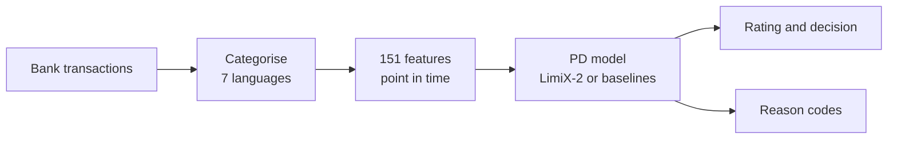
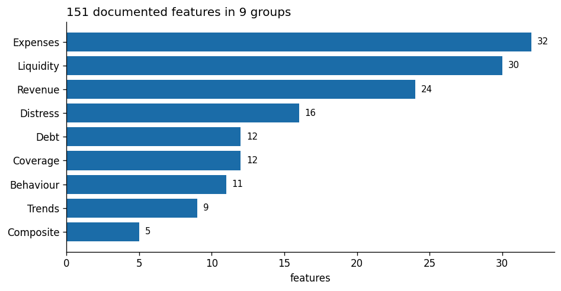
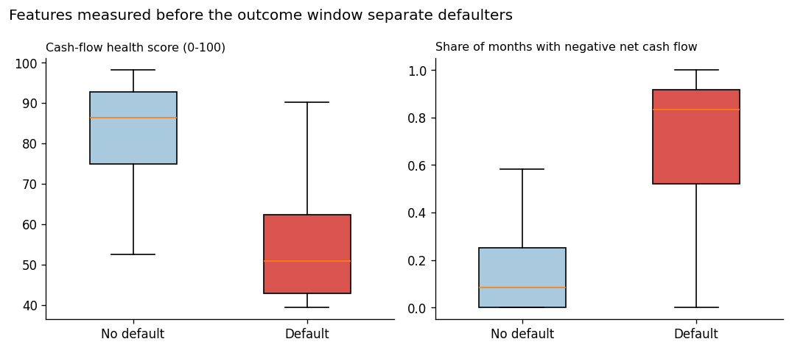
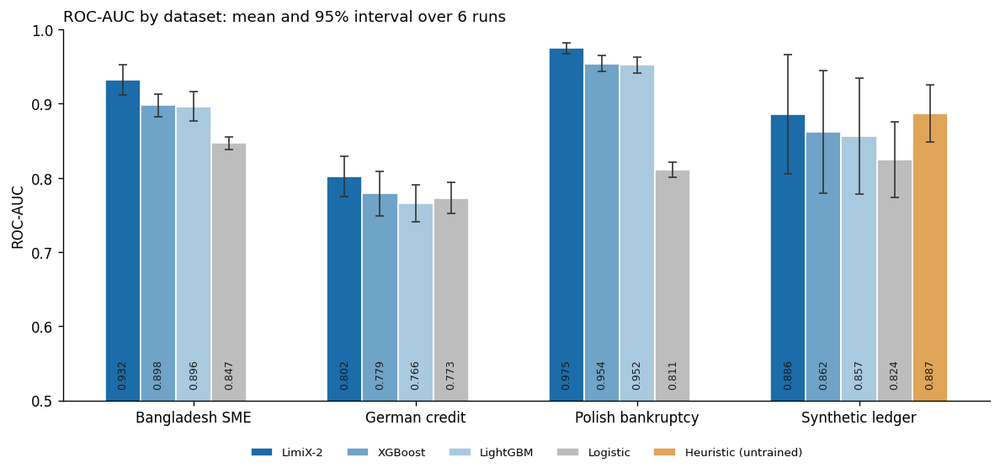
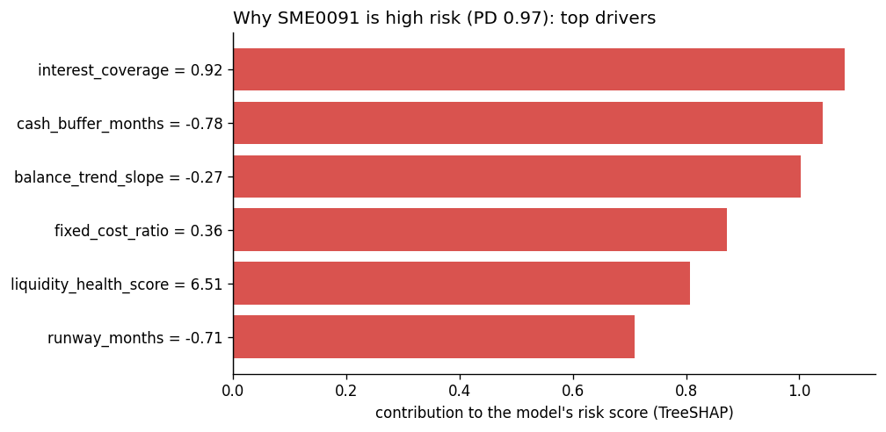

# OpenCashFlow

[](https://github.com/youssbm/opencashflow/actions/workflows/ci.yml)
[](LICENSE)
[](pyproject.toml)

**Underwrite SMEs from their bank transactions, not only their accounts.**

SME credit decisions often rest on financial statements that are months old. A bank statement is current, and it shows how a business really moves money: who pays it, when rent leaves, and whether payroll clears before the overdraft starts to bite. OpenCashFlow turns that ledger into a probability of default (PD), a rating, a decision and reasons a credit officer can read.

| | |
|---|---|
| **Read** | Bank narratives in seven languages become categories, each with a confidence and a matched rule. |
| **Measure** | 151 documented features. With `as_of` set, only transactions dated on or before it are used. |
| **Score** | LimiX-2, a tabular foundation model, against LightGBM, XGBoost, logistic regression and an untrained scorecard. |
| **Explain** | Reason codes for each scored company, from TreeSHAP or occlusion. |



## What it predicts

Each dataset asks the model a different question. The base rate is what a useful model has to beat.

| Dataset | Predicts | Rows | Inputs | Base rate | Licence |
|---|---|---:|---|---:|---|
| Synthetic ledger (`synthetic`) | Default in the 12 months after the observation window | 300 companies, 167,593 transactions | 151 cash-flow features | 11.3% | Apache-2.0 |
| German credit (`german`) | Bad credit risk | 1,000 | 20 applicant attributes | 30.0% | CC BY 4.0 |
| Bangladesh SME (`bangladesh_sme`) | Missed a scheduled payment in the 12 months after disbursement | 1,200 | 19 structured features | 25.25% | CC BY 4.0 data, MIT code |
| Polish bankruptcy (`polish`) | Bankruptcy five years after the statements (`1year`) | 7,027 | 64 financial ratios | 3.9% | CC BY 4.0 |
| SBA National loans (`sba`) | Loan charge-off | 897,167 labelled | 21 approval-time features | 17.6% | CC BY-SA 4.0 |

<details>
<summary><b>Dataset previews</b>: real ledger rows and the column names of the public datasets</summary>

**Synthetic ledger** (generated locally, seed 42):

| entity_id | date | amount | currency | description | counterparty | balance |
|---|---|---:|---|---|---|---:|
| SME0001 | 2023-01-02 | -5,281.25 | EUR | LOYER BUREAU Paris | Landlord Paris | 8,683.46 |
| SME0001 | 2023-01-03 | -13,699.66 | EUR | FACTURE FOURNISSEUR Hanseatic Wholesale | Hanseatic Wholesale | -5,016.20 |
| SME0001 | 2023-01-04 | -607.64 | EUR | PAIEMENT CARTE Uber | Uber | -5,623.84 |
| SME0001 | 2023-01-06 | -426.63 | EUR | INTERETS PRET | Lender | -6,050.47 |

The public datasets are not copied into this repository, so their columns are listed instead.

- **German credit:** `checking_status`, `duration_months`, `credit_history`, `purpose`, `credit_amount`, `savings_status`, `employment_since`, `installment_commitment`, `personal_status_sex`, `other_debtors`, `residence_since`, `property_magnitude`, `age_years`, `other_installment_plans`, `housing`, `existing_credits`, `job`, `num_dependents`, `telephone`, `foreign_worker`
- **Bangladesh SME** (after removing the leakage column and the text narratives): `sector`, `business_age_years`, `legal_status`, `division`, `location_type`, `employees_count`, `monthly_revenue_bdt`, `monthly_profit_bdt`, `existing_loans`, `prior_loan_count`, `late_payment_history`, `loan_purpose`, `loan_amount_bdt`, `preferred_tenure_months`, `collateral_level`, `cashflow_stability`, `repayment_confidence`, `owner_education`, `days_payable_outstanding`
- **Polish bankruptcy:** `Attr1` to `Attr64`, financial ratios, all numeric
- **SBA National:** `approval_fy`, `approval_month`, `term_months`, `term_years`, `employees`, `create_job`, `retained_job`, `jobs_supported`, `gross_approval`, `sba_approval`, `sba_guarantee_ratio`, `loan_per_employee`, `jobs_per_employee`, `state`, `bank_state`, `naics_sector`, `new_exist`, `urban_rural`, `rev_line_cr`, `low_doc`, `is_franchise`

</details>

## What the features see

Nine groups cover coverage, revenue, expenses, liquidity, debt, distress, behaviour, trends and composite health. Each feature is declared once in code and documented in the [feature dictionary](docs/features.md).



Features measured before the outcome window separate the two groups. In the 300-company benchmark portfolio, the median cash-flow health score is 86 for companies that did not default and 51 for those that did. The median share of months with negative net cash flow is 8% for the first group and 83% for the second.



## How well it works



| Dataset | LimiX-2 | XGBoost | LightGBM | Logistic | Heuristic (untrained) |
|---|---:|---:|---:|---:|---:|
| Bangladesh SME | **0.932** | 0.898 | 0.896 | 0.847 | n/a |
| German credit | **0.802** | 0.779 | 0.766 | 0.773 | n/a |
| Polish bankruptcy | **0.975** | 0.954 | 0.952 | 0.811 | n/a |
| Synthetic ledger | 0.886 | 0.862 | 0.857 | 0.824 | **0.887** |

Mean ROC-AUC over 6 runs (3-fold cross-validation, 2 repeats). The intervals are in the chart, and the full numbers are in the [saved summary](benchmarks/results/benchmark_summary.md).

Read the table with these caveats:

- **LimiX-2 leads on the three public datasets.** On the synthetic ledger it is level with the untrained scorecard, and their intervals overlap heavily. The scorecard's drivers overlap with the generator's, so that tie is not an independent test.
- **Calibration tells a similar story.** Brier scores are lowest for LimiX-2 on Bangladesh (0.089), German credit (0.160) and the synthetic ledger (0.048). On Polish, the tree models are marginally better (0.016 against 0.017).
- **SBA loans need a caveat.** LimiX-2 scores 0.976 on a random 5,000-row sample with approval-time features, but much of that depends on the `term` column. Without it, random-CV AUC falls to 0.82, and out of time it falls to about 0.6. Term has not been verified as known at approval, so these are not approval-time PD results. See [`benchmarks/results/sba`](benchmarks/results/sba).

These are reproducible internal comparisons, not a leaderboard. AUC does not show calibration, so the saved results also report KS, PR-AUC, Brier score and log loss.

## Why a company is risky



In a 120-company run, the riskiest company (PD 0.97) covers only 0.92 times its interest bill, runs a negative cash buffer and has a falling balance. Each bar is one feature's TreeSHAP contribution to the model's score, largest first.

Reason codes are model-relative statements. They are not causal claims and not regulated adverse-action codes.

## Quick start

```bash
python -m venv .venv
source .venv/bin/activate        # Windows: .venv\Scripts\Activate.ps1
python -m pip install -e ".[trees,dev]"
```

```python
from opencashflow.data.synthetic import generate_portfolio
from opencashflow.features.cashflow_features import FeatureConfig
from opencashflow.pipeline import CashFlowPipeline

portfolio = generate_portfolio(n_companies=120, months=20, seed=42)
config = FeatureConfig(as_of=portfolio.metadata["observation_end"])
pipeline = CashFlowPipeline(config=config, scorer="lightgbm")
pipeline.fit(portfolio.transactions, portfolio.labels)

scored = pipeline.predict(portfolio.transactions, top_k=3, ead=25_000)
print(scored[["pd", "rating", "decision"]].head(3))
summary = pipeline.portfolio_summary(scored)
print(f"{summary['n_entities']} companies, mean PD {summary['mean_pd']:.1%}, "
      f"approval rate {summary['approval_rate']:.1%}, decisions {summary['decisions']}")
```

Output:

```
                 pd rating decision
entity_id
SME0091    0.971538      G  decline
SME0030    0.970920      G  decline
SME0117    0.969357      G  decline
120 companies, mean PD 11.7%, approval rate 85.8%, decisions {'accept': 103, 'decline': 14, 'review': 3}
```

`as_of` fixes the scoring date. Without it, each company is scored at its latest transaction date and a warning is raised, which is not point-in-time. With no labels, use the untrained scorecard:

```python
pipeline = CashFlowPipeline(config=config, scorer="heuristic").fit(portfolio.transactions)
```

From the command line:

```bash
opencashflow demo --companies 80 --scorer heuristic
opencashflow download polish german bangladesh_sme
```

The second command downloads the public datasets into `data/raw`, which is gitignored.

## LimiX-2

LimiX-2 is a tabular foundation model. In this repository `fit` stores a reference set and `predict` runs the frozen checkpoint, so nothing is trained here. Set the checkpoint and source paths before using `scorer="limix"`:

```bash
export LIMIX_MODEL_PATH=/path/to/LimiX-2-1016.ckpt
export LIMIX_SRC=/path/to/LimiX
```

The weights are under the StableAI LimiX Non-Commercial Licence v1.0, and this repository does not redistribute them. Commercial use needs a separate agreement with Stable AI. On CPU, LimiX is the slow option, and the saved benchmarks take minutes per fold. Setup, pinned commits and troubleshooting are in [docs/limix.md](docs/limix.md).

## Documentation

| Guide | What it covers |
|---|---|
| [Quickstart](docs/examples/quickstart.md) | Scoring, explanations, saving and benchmarks |
| [Feature dictionary](docs/features.md) | All 151 features with formulas and direction |
| [Datasets](docs/datasets.md) | Sources, licences, leakage rules and citations |
| [Transactions](docs/examples/transactions.md) | Mapping your bank export to the canonical schema |
| [LimiX-2](docs/limix.md) | Setup, pinned versions and troubleshooting |
| [Architecture](docs/architecture.md) | Layers, contracts and design decisions |

## Limitations

- The public SME datasets are accounting or application tables, not transaction ledgers. Only the synthetic portfolio runs the full transaction pipeline end to end.
- The synthetic labels come from a documented generator. Results there show that the pipeline works, not how it performs on a real lender's book.
- LimiX-2 weights are non-commercial and are not bundled.
- Scores are raw model outputs. A calibration step is on the roadmap.
- Reason codes are model-relative, not causal, and not regulated adverse-action codes.
- Policy thresholds are illustrative and not calibrated to any lender's risk appetite.
- Tested locally on Python 3.13. CI covers Python 3.10 to 3.13.

## Development

```bash
python -m pytest -q
python -m ruff check opencashflow tests benchmarks
python scripts/make_readme_figures.py     # rebuilds the charts in docs/assets
```

On a clean checkout the fast suite passes 343 tests and skips 9: five LimiX integration tests and four tests that need the datasets in `data/raw`. With the datasets present, 347 pass. The published benchmark commands and the release checklist are in [CONTRIBUTING.md](CONTRIBUTING.md).

## Roadmap

- Calibrated PDs with isotonic or Platt scaling.
- More bank-narrative packs and merchant normalisation.
- Open-banking adapters (PSD2 account information) behind a stable data contract.

## Citation

```bibtex
@software{opencashflow2026,
  title   = {OpenCashFlow: Cash-flow underwriting for SME credit risk},
  author  = {Ben Mahmoud, Youssef and {OpenCashFlow contributors}},
  year    = {2026},
  version = {0.1.0},
  url     = {https://github.com/youssbm/opencashflow}
}
```

Dataset citations are in [docs/datasets.md](docs/datasets.md). If you use LimiX-2, cite it as its model card asks and disclose the checkpoint and code commits.

## Licence

Code: [Apache-2.0](LICENSE). Datasets keep their own licences, shown in the table above. LimiX-2 weights: StableAI LimiX Non-Commercial License v1.0.

## Project owner

OpenCashFlow is owned by **Youssef Ben Mahmoud** ([@youssbm](https://github.com/youssbm)). The owner is requested as reviewer on every pull request ([CODEOWNERS](.github/CODEOWNERS)).

## Contributing

Read [CONTRIBUTING.md](CONTRIBUTING.md) and [AGENTS.md](AGENTS.md). Report security issues privately through the Security tab, as described in [SECURITY.md](SECURITY.md), not in public issues.
