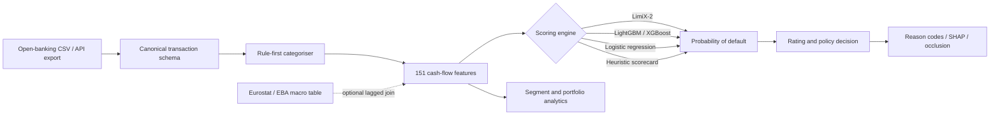

# Architecture

OpenCashFlow is a four-layer system: data, features, models, and the underwriting pipeline. Each
layer has an explicit contract so that it can be tested and replaced independently.



## Layer contracts

### Data layer

`opencashflow.data.schema.normalize_transactions` accepts aliases, signed or unsigned amounts, and
European number formats, then returns a canonical table. The canonical contract is:

* one row per transaction;
* `entity_id`, `date`, signed `amount`, `description`;
* optional `counterparty`, `balance`, `currency`, `category`;
* `direction` derived from the sign.

All loaders return a `DatasetBundle` with `X`, `y`, attribution and metadata. Raw files are never
committed.

### Feature layer

`TransactionCategorizer` is rule-first: transparent patterns, direction-aware, multilingual, with an
optional TF-IDF character n-gram fallback. The rule set is data, not code, so users can insert rules
without rewriting the engine.

`CashFlowFeatureExtractor` computes one row per entity over a configurable window. Every feature is
declared in `features/specs.py`; the builder fails if code and catalogue drift. Features cover
coverage, revenue, expenses, liquidity, debt, distress, behaviour, trends and composite scores.

Key choices:

* **Safe arithmetic everywhere.** `safe_div`, HHI, entropy, slope, drawdown and seasonality helpers
  handle empty, zero and non-finite inputs.
* **No silent infinities.** Outputs are cleaned and clipped.
* **Point-in-time by default.** Pass `as_of` for production and out-of-time validation.
* **Partial months are visible.** `months_observed` and `coverage_ratio` describe the window.
* **No target-derived features.** The synthetic `stress` variable and the Bangladesh leakage column
  are excluded.

### Model layer

All scorers expose `fit`, `predict_proba`, `predict` and `predict_pd`. The positive class is the
second sorted class; encode default as `1`.

* `LimiXScorer` performs in-context inference. `fit` stores the reference set; the checkpoint loads
  lazily on first prediction.
* `TreeBaseline` wraps LightGBM or XGBoost with categorical encoding and native missing-value
  handling.
* `LogisticBaseline` is a scikit-learn pipeline with median imputation, scaling, one-hot encoding
  and L2 regularisation.
* `HeuristicScorer` is a fixed, explainable scorecard for demos and no-label situations.

`models/explain.py` provides TreeSHAP for tree models, occlusion for any `predict_pd` model
(including LimiX), and additive contributions for the heuristic scorecard. Reason codes are
model-relative, not causal.

### Pipeline layer

`CashFlowPipeline` composes everything:

```text
fit:      transactions + labels -> categoriser -> features -> scorer
predict:  transactions -> features -> PD -> rating -> policy decision -> reasons
```

`UnderwritingPolicy` is illustrative: approve below a PD cut-off, review in a band, decline above
it, and refer cases with too little history. Persistence uses joblib; LimiX weights are excluded and
reloaded lazily.

## Design decisions

### Why a transaction-level toolkit when public SME data is tabular?

Public bankruptcy datasets contain accounting ratios, not bank ledgers. They are valuable for
testing the scoring layer but cannot validate transaction categorisation, liquidity features or
open-banking realism. The synthetic generator fills that gap with a documented, reproducible
process, while the public datasets anchor the modelling layer to real outcomes.

### Why rules before ML for categorisation?

Rules are auditable, deterministic and easy to correct. A small char n-gram model is available as a
fallback, but it does not replace the rules. Users can add country-specific patterns without
retraining.

### Why LimiX plus trees?

LimiX-2 is the strongest tabular model on TabArena at the time of writing and works well in the
small-sample regime typical of SME credit. Trees are faster, cheaper and easier to explain, and
logistic regression remains the regulatory reference. Reporting all three keeps claims honest.

### Why 151 features?

The goal is coverage of the cash-flow drivers that credit analysts actually use, not a minimal
feature set. The catalogue is grouped and documented; users can select subsets for parsimony or
regulatory constraints. Feature selection should be fitted inside the training fold.

### Why no gradient training for LimiX?

The checkpoint is designed for in-context learning. Fine-tuning would require substantial labelled
data, compute and a new licence review. The wrapper deliberately treats LimiX as a frozen scoring
engine.

## Failure modes and guardrails

| Failure | Guardrail |
|---|---|
| Target leakage | Explicit leakage list in the Bangladesh loader; synthetic labels use post-ledger outcomes, not latent stress |
| Look-ahead bias | `as_of` parameter; benchmark fits preprocessing inside folds |
| Silent NaN/inf | Finite-value tests, cleaning and clipping |
| Category drift | Rule catalogue is explicit; ML fallback can be retrained |
| Model overconfidence | Brier and log-loss reported alongside AUC; calibration table helper |
| Small samples | Stratified folds, reported fold variance, no quality claims from tiny fixtures |
| LimiX unavailable | `availability()` with actionable reasons; benchmark skips gracefully |
| Non-commercial misuse | Licence notice in code, docs and README |
| Raw data redistribution | Download scripts, `.gitignore`, attribution metadata |

## Extension points

* **New country narratives:** add `CategoryRule` entries or a new template in `synthetic.py`.
* **New features:** add a `FeatureSpec` and a `builder.add` call; regenerate the docs.
* **New dataset:** add a loader, registry entry, fixture test and docs.
* **New model:** implement `fit`, `predict_proba`, `predict_pd`; use `OcclusionExplainer` if it has
  no TreeSHAP support.
* **New policy:** subclass or replace `UnderwritingPolicy`; keep the decision labels stable.
* **Macro context:** use `MacroFeatureJoiner` with a tidy country/period/indicator/value table and
  explicit lags.

## Repository conventions

See [`AGENTS.md`](../AGENTS.md) for the full engineering contract, including the LimiX runbook,
test commands, style rules and release checklist.
