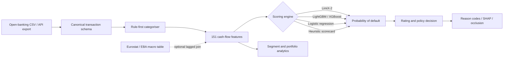

# Architecture

OpenCashFlow is a four-layer system: data, features, models, and the underwriting pipeline. Each
layer has an explicit contract so that it can be tested and replaced independently.



## Layer contracts

### Data layer

`opencashflow.data.schema.normalize_transactions` accepts aliases, signed or unsigned amounts, and
European number formats, then returns a canonical table. The canonical contract is:

* one row per transaction;
* `entity_id`, `date`, signed `amount`, `description`;
* optional `counterparty`, `balance`, `currency`, `category`;
* `direction` derived from the sign.

All loaders return a `DatasetBundle` with `X`, `y`, attribution and metadata. Raw files are never
committed.

### Feature layer

`TransactionCategorizer` is rule-first: transparent patterns, direction-aware, multilingual, with an
optional TF-IDF character n-gram fallback. Rules are `CategoryRule` objects declared in Python
(`DEFAULT_RULES`); pass the `rules` argument to replace them. There is no external rules file.

`CashFlowFeatureExtractor` computes one row per entity over a configurable window. Every feature is
declared in `features/specs.py`; the builder fails if code and catalogue drift. Features cover
coverage, revenue, expenses, liquidity, debt, distress, behaviour, trends and composite scores.

Key choices:

* **Safe arithmetic everywhere.** `safe_div`, HHI, entropy, slope, drawdown and seasonality helpers
  handle empty, zero and non-finite inputs.
* **No silent infinities.** Outputs are cleaned and clipped.
* **Point-in-time requires `as_of`.** Pass `as_of` for production and out-of-time validation.
  Without it, features use each entity's latest transaction date and a UserWarning is raised.
* **Partial months are visible.** `months_observed` and `coverage_ratio` describe the window.
* **No target-derived features.** The Bangladesh leakage column is excluded. For the synthetic
  generator, a latent `stress` variable drives both the ledger and the default probability, but it
  is not exposed as a feature.

### Model layer

All scorers expose `fit`, `predict_proba`, `predict` and `predict_pd`. The positive class is the
second sorted class; encode default as `1`.

* `TreeBaseline` wraps LightGBM or XGBoost with categorical encoding and native missing-value
  handling. `class_weight` defaults to `None`, so probabilities are not reweighted; pass `balanced`
  to reweight. LightGBM receives ordinal-encoded categorical columns; XGBoost receives ordinal
  codes, which is a documented limitation.
* `LogisticBaseline` is a scikit-learn pipeline with imputation, scaling and one-hot encoding.
  `numeric_transform` defaults to `quantile`, a normal quantile transform fitted inside each
  training fold; `standard` gives the older scaler. `class_weight` also defaults to `None`.
* `LimiXScorer` performs in-context inference. `fit` stores the reference set; the checkpoint loads
  lazily on first prediction. `softmax_temperature` defaults to `None`, which resolves to 0.9 for
  classification and 1.0 for regression. Imputation replaces only missing cells and leaves observed
  cells unchanged; if LimiX returns NaN for a missing cell, the training median is used and a
  UserWarning is raised.
* `HeuristicScorer` is a fixed, explainable scorecard for demos and no-label situations.

LimiX limitations: the wrapper encodes categories in alphabetical order, and LimiX infers categorical
columns itself. With at least 100 training rows, a column with fewer than 4 unique training values
is treated as categorical (upstream defaults); unseen categories map to -1. LimiX classification
median-fills missing values, so the signal in missingness is lost. On Polish, the NaN count alone
gives AUC 0.725.

`models/explain.py` provides TreeSHAP for tree models, occlusion for any `predict_pd` model
(including LimiX), and additive contributions for the heuristic scorecard. Reason codes are
model-relative, not causal. They list only risk-increasing features, largest first, and are
illustrative adverse-action style statements, not regulated reason codes. Occlusion explanations use
the training features as reference (the pipeline passes them as background); features are chosen per
row by standardised deviation.

### Pipeline layer

`CashFlowPipeline` composes everything:

```text
fit:      transactions + labels -> categoriser -> features -> scorer
predict:  transactions -> features -> PD -> rating -> policy decision -> reasons
```

Pass `as_of` through `FeatureConfig` or to `predict` for point-in-time scoring. Without it, features
use each entity's latest transaction date and a UserWarning is raised. The fitted pipeline keeps the
training feature matrix as `training_features_` for use as the occlusion background, and joblib
pickles include it; LimiX weights are excluded and reloaded lazily.

`UnderwritingPolicy` is illustrative: approve below a PD cut-off, review in a band, decline above
it, and refer cases with too little history.

## Design decisions

### Why a transaction-level toolkit when public SME data is tabular?

Public bankruptcy datasets contain accounting ratios, not bank ledgers. They are valuable for
testing the scoring layer but cannot validate transaction categorisation, liquidity features or
open-banking realism. The synthetic generator fills that gap with a documented, reproducible
process, while the public datasets anchor the modelling layer to real outcomes.

### Why rules before ML for categorisation?

Rules are auditable, deterministic and easy to correct. A small char n-gram model is available as a
fallback, but it does not replace the rules. Users can add country-specific patterns without
retraining.

### Why LimiX plus trees?

LimiX-2 is evaluated in this repository against tree and logistic baselines on four public datasets
and one synthetic portfolio. Among the trained models it has the highest mean ROC-AUC on all four
datasets, but its interval overlaps the next model's on German, on synthetic and on Bangladesh (by
0.001), and it is clearly separated on Polish. On synthetic data it is level with the untrained
heuristic. It is also much slower: about 286 s per fold on Polish on this CPU, versus under 0.1 s for
the tree models. Trees are faster, cheaper and easier to explain, and logistic regression remains the
regulatory reference. Reporting all three keeps claims honest. See
[benchmark results](../benchmarks/results/benchmark_summary.md).

### Why 151 features?

The goal is coverage of the cash-flow drivers that credit analysts actually use, not a minimal
feature set. The catalogue is grouped and documented; users can select subsets for parsimony or
regulatory constraints. Feature selection should be fitted inside the training fold.

### Why no gradient training for LimiX?

The checkpoint is designed for in-context learning. Fine-tuning would require substantial labelled
data, compute and a new licence review. The wrapper deliberately treats LimiX as a frozen scoring
engine.

## Failure modes and guardrails

| Failure | Guardrail |
|---|---|
| Target leakage | Explicit leakage list in the Bangladesh loader; the synthetic label depends on a latent stress that also drives the ledger, and stress is not a feature |
| Look-ahead bias | `as_of` parameter; a UserWarning is raised when it is absent; benchmark fits preprocessing inside folds |
| Silent NaN/inf | Finite-value tests, cleaning and clipping |
| Category drift | Rules are `CategoryRule` objects in Python; ML fallback can be retrained |
| Model overconfidence | Brier and log-loss reported alongside AUC; calibration table helper; no calibration step is shipped |
| Small samples | Stratified folds, reported fold variance, no quality claims from tiny fixtures |
| Missing balance column | A UserWarning says balance features are cumulative-flow proxies, not account balances |
| Multiple currencies | An entity with more than one currency raises `TransactionSchemaError`; no FX conversion is done |
| Account-level identifiers | If a source has only account-level identifiers, the account becomes the entity and a UserWarning says so |
| LimiX unavailable | `availability()` with actionable reasons; benchmark skips gracefully |
| Non-commercial misuse | Licence notice in code, docs and README |
| Raw data redistribution | Download scripts, `.gitignore`, attribution metadata |

## Extension points

* **New country narratives:** add `CategoryRule` entries or a new template in `synthetic.py`.
* **New features:** add a `FeatureSpec` and a `builder.add` call; regenerate the docs.
* **New dataset:** add a loader, registry entry, fixture test and docs.
* **New model:** implement `fit`, `predict_proba`, `predict_pd`; use `OcclusionExplainer` if it has
  no TreeSHAP support.
* **New policy:** subclass or replace `UnderwritingPolicy`; keep the decision labels stable.
* **Macro context:** use `MacroFeatureJoiner` with a tidy country/period/indicator/value table and
  explicit lags.

## Repository conventions

See [`AGENTS.md`](../AGENTS.md) for the full engineering contract, including the LimiX runbook,
test commands, style rules and release checklist.
