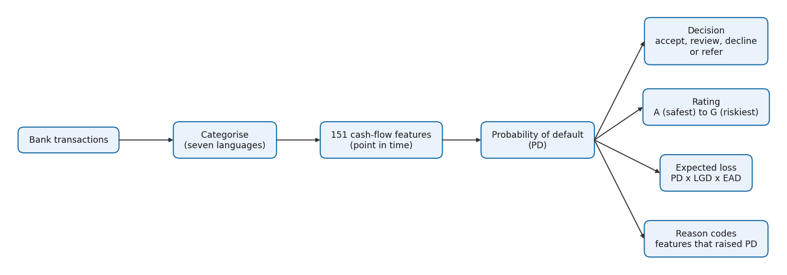
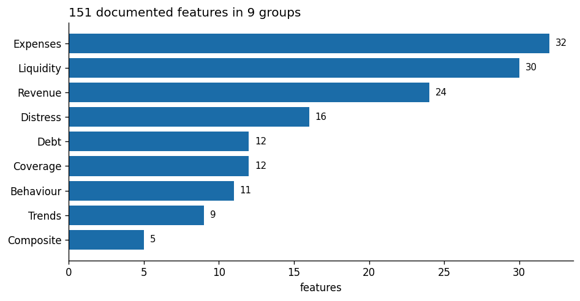
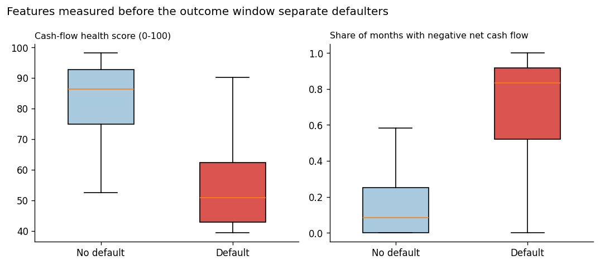
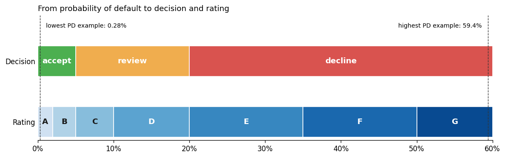
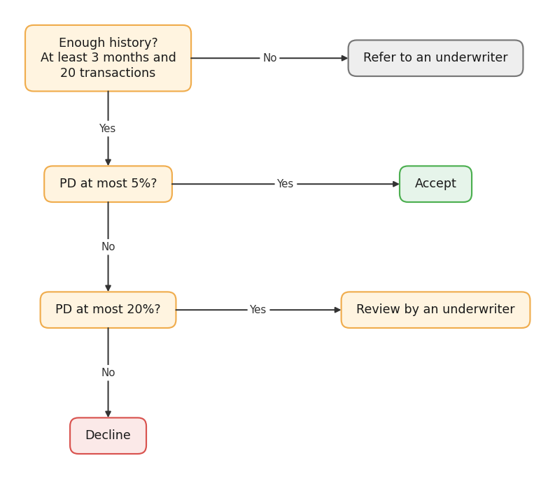
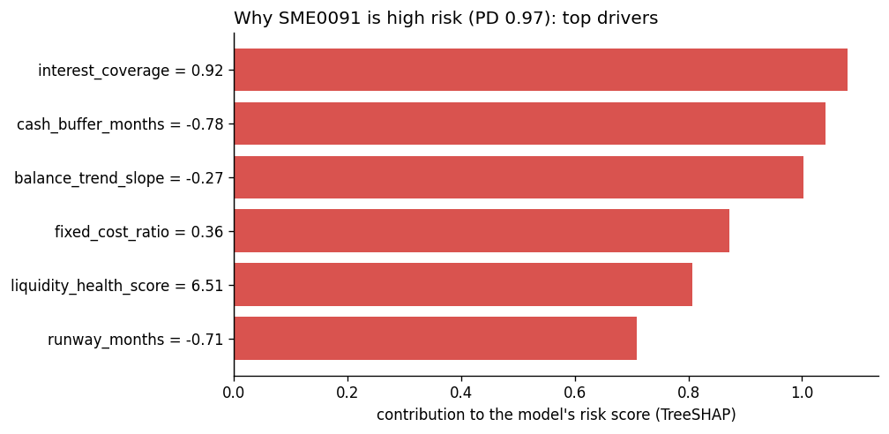
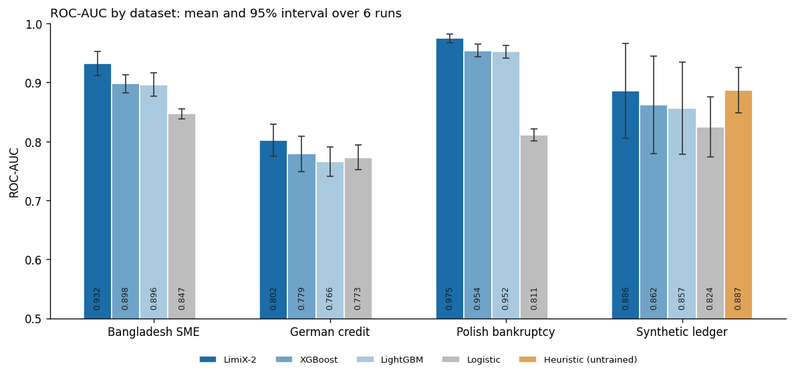

# How OpenCashFlow makes a credit decision

This page explains the business logic one step at a time. Start at the top. Each step builds on the one before it, so you can stop after Step 3 and still understand the core idea.

> The numbers here come from the code in this repository. The cut-offs are illustrative. A real lender sets its own, using its risk appetite and its own data.

## Step 0. The objective

A lender wants to answer one question before it lends to a small business:

> Will this business repay the loan as agreed over the next year?

OpenCashFlow answers that question from the business's bank transactions, not only from its accounts. For each business, the output is a probability of default, a rating, a decision and the reasons behind the score.

Five terms come up on every page:

| Term | Plain meaning |
|---|---|
| Transaction | One line from a bank statement: date, amount, description and, optionally, balance. |
| Feature | A number that summarises behaviour, for example how often the balance went negative. |
| PD (probability of default) | The chance that the business defaults in the window the model was built for. |
| Rating | A letter from A (safest) to G (riskiest), based on PD. |
| Reason codes | The features that pushed this business's PD up the most. |

## Step 1. Start with the bank statement

A bank statement is current, while financial accounts can be months old. A statement shows how money moves: revenue in, payroll and rent out, loan repayments, overdrafts and failed payments.

For each transaction, the toolkit needs a date, an amount (positive for money in, negative for money out) and a description. Balances are optional, but they make the liquidity features much stronger. The [transactions guide](examples/transactions.md) shows how to map a bank export to this format.

Each line is then labelled by category: revenue, payroll, suppliers, tax, loan repayments and more. The labels come from rules that work in seven languages, and each label records its confidence and the rule that matched.

Example rows from the synthetic ledger. The toolkit generates them, so they are not real data:

| entity_id | date | amount | description | balance |
|---|---|---:|---|---:|
| SME0001 | 2023-01-02 | -5,281.25 | LOYER BUREAU Paris | 8,683.46 |
| SME0001 | 2023-01-03 | -13,699.66 | FACTURE FOURNISSEUR Hanseatic Wholesale | -5,016.20 |
| SME0001 | 2023-01-04 | -607.64 | PAIEMENT CARTE Uber | -5,623.84 |

## Step 2. Define what "default" means

The model learns from labelled examples, and each example records whether the business defaulted. The definition depends on the dataset:

| Dataset | What the label means | Share of defaults |
|---|---|---:|
| Synthetic ledger | Defaulted within the 12 months after the observation window | 11.3% |
| German credit | Classed as bad credit risk | 30.0% |
| Bangladesh SME | Missed a scheduled payment in the 12 months after disbursement | 25.25% |
| Polish bankruptcy | Went bankrupt five years after the statements (`1year` variant) | 3.9% |
| SBA National loans | Loan was charged off | 17.6% |

The share of defaults is the base rate. A useful model must separate risky from safe businesses better than this rate alone would.

Two rules apply to every dataset:

- **No looking ahead.** A feature may only use information from before the scoring date. Using later information would leak the answer.
- **No leaking columns.** A column that restates the label, or that is only known after the decision, is removed. The Bangladesh loader drops one such column by default. The SBA loader excludes five post-approval columns.

## Step 3. Turn transactions into features

A feature is a formula applied to a business's transactions up to the scoring date. The toolkit computes 151 features in nine groups:

Start with six. Each one answers a plain question:

| Feature | Question it answers | Higher value means |
|---|---|---|
| `net_cash_flow_negative_ratio` | In what share of months did money out exceed money in? | worse |
| `overdraft_ratio` | What share of days was the account overdrawn? | worse |
| `revenue_cv` | How bumpy is monthly revenue? | worse |
| `debt_service_ratio` | What share of revenue goes to loan repayments? | worse |
| `cash_buffer_months` | How many months of expenses does the low-point balance cover? | better |
| `interest_coverage` | How many times does operating cash cover interest? (capped at 20) | better |

The full dictionary, with every formula, is in the [feature dictionary](features.md).

**Why the scoring date matters.** Suppose a business is scored on 1 March. A feature that uses a transaction from 15 March would be using the future. Setting `as_of` to the scoring date makes the features ignore anything later.

## Step 4. Estimate the probability of default (PD)

Three approaches produce a PD. You don't need to understand all of them to use the toolkit.

| Approach | Needs labelled defaults? | The idea |
|---|---|---|
| Untrained scorecard | No | Fixed weights on a few features, turned into a probability |
| Trained models (LightGBM, XGBoost, logistic regression) | Yes | Learn which patterns of features went with defaults in the past |
| LimiX-2 | Yes | A pretrained tabular foundation model that uses the labelled examples as context. Nothing is trained in this repository |

### The scorecard in plain words

The untrained scorecard works like a points system:

1. Start from a base of -2.1.
2. Add points for risky behaviour: negative cash-flow months, overdrafts, bumpy revenue, heavy debt service, failed payments, gambling.
3. Subtract points for healthy behaviour: a bigger cash buffer, a longer runway, growing revenue, a high health score.
4. Convert the total into a probability between 0% and 100%.

Step 4 is a logistic function: `PD = 1 / (1 + e^(-z))`, where `z` is the base plus the points.

Why these features? In the synthetic portfolio, businesses that defaulted had much lower health scores and far more months with negative cash flow:

In that 300-company run, the median health score was 86 for businesses that did not default and 51 for those that did. The median share of negative-cash-flow months was 8% for the first group and 83% for the second.

Worked example: two businesses from a 120-company synthetic run, with the points each feature adds or subtracts:

| Feature | Highest PD business | Lowest PD business |
|---|---|---|
| Months with negative net cash flow | 100% (adds 2.0 points) | 0% (adds 0 points) |
| Overdrawn days | 82% (adds 1.2 points) | 0% (adds 0 points) |
| Cash-flow health score (0 to 100) | 40 (subtracts 1.4 points) | 98 (subtracts 3.4 points) |
| **PD** | **59.4%** | **0.28%** |

The full table, with all ten features, is in the details below.

Under the hood: the ten scorecard weights

The weights and clipping ranges come from `HEURISTIC_WEIGHTS` and `HEURISTIC_CLIPS` in `opencashflow/models/baselines.py`. Each value is clipped to its range, then multiplied by its weight.

| Feature | Weight | Clipped to |
|---|---:|---|
| `revenue_cv` | +1.8 | 0 to 2 |
| `net_cash_flow_negative_ratio` | +2.0 | 0 to 1 |
| `overdraft_ratio` | +1.5 | 0 to 1 |
| `debt_service_ratio` | +2.2 | 0 to 1 |
| `nsf_rate` | +8.0 | 0 to 0.2 |
| `gambling_to_expense` | +2.0 | 0 to 0.2 |
| `revenue_growth_3m` | -0.8 | -1 to 1 |
| `cash_buffer_months` | -0.06 | -6 to 12 |
| `runway_months` | -0.04 | -6 to 24 |
| `cashflow_health_score` | -0.035 | 0 to 100 |

The intercept is -2.1. The scorecard is for demonstrations and as a prior when no labels exist. It is not calibrated, and on the synthetic data it is not an independent baseline, because its drivers overlap with the generator's.

### What the trained models add

Trained models learn their weights from labelled history, so they can find patterns a hand-set scorecard misses. Their PDs are checked with the same metrics (Step 7).

## Step 5. Turn PD into a decision, a rating and an expected loss

Before any PD is used, the toolkit checks whether there is enough history: at least 3 months and at least 20 transactions. If there isn't, the case is **referred** to a person, and no score is used.

With enough history, PD sets the decision:

The rating groups PD into bands. A PD up to 2% gets an A, and a PD above 50% gets a G:

| Rating | PD up to |
|---|---|
| A | 2% |
| B | 5% |
| C | 10% |
| D | 20% |
| E | 35% |
| F | 50% |
| G | above 50% |

The expected loss estimates how much the lender could lose on average:

**Expected loss = PD × LGD × EAD**

- **PD**: the probability of default.
- **LGD (loss given default)**: the share of the loan that is lost if default happens. The toolkit uses 45% by default.
- **EAD (exposure at default)**: the amount owed when default happens. The examples use 25,000.

For the two businesses in Step 4, on a 25,000 exposure:

- Highest PD (59.4%): 0.594 × 0.45 × 25,000, about 6,680
- Lowest PD (0.28%): 0.0028 × 0.45 × 25,000, about 32

The thresholds, rating bands and 45% LGD are defaults in the code, set for demonstration. Set your own from your risk appetite before using the toolkit for real decisions.

## Step 6. Explain each score

Each scored business comes with reason codes: the features that raised its PD the most, largest first. Only risk-increasing features are listed.

For the riskiest business in the quickstart run, the first reason reads: "Operating cash available divided by interest, capped at 20 (interest_coverage) increased predicted risk." In plain words, its operating cash covers only 0.92 times its interest bill, so it cannot pay interest from operating cash.

Reason codes describe what the model relied on. They do not prove what caused a default. They are also not the regulated adverse-action codes a lender must send to a borrower.

## Step 7. Test whether the scores work

Four questions matter:

1. **Does the score rank businesses?** ROC-AUC measures this. 0.5 is guessing, and 1.0 is perfect ranking.
2. **Are the probabilities right?** The Brier score, log loss and calibration tables check whether a PD of 10% really means about one default in ten.
3. **Does it hold on new data?** An out-of-time test trains on older applications and tests on newer ones.
4. **Is the comparison fair?** Every model sees the same folds, preprocessing is fitted inside each fold, and results are repeated to give intervals.

At a glance, over six runs per model:

- LimiX-2 has the highest mean ROC-AUC on Bangladesh SME (0.932), German credit (0.802) and Polish bankruptcy (0.975).
- On the synthetic ledger it is level with the untrained scorecard (0.886 against 0.887). That tie is not an independent test.

A high AUC does not guarantee good probabilities. A model can rank well and still overstate every PD, which is why calibration is checked separately.

## Step 8. Limits: what this toolkit is not

- **It is not a lending policy.** The cut-offs, rating bands and 45% LGD are demonstration defaults.
- **It is not calibrated.** Scores are raw model outputs. Calibrate on your own labelled outcomes before treating a PD as a real probability.
- **Most public datasets are not transaction ledgers.** Only the synthetic ledger runs the full transaction pipeline. The German, Bangladesh, Polish and SBA data are accounting, application or loan tables.
- **Synthetic labels come from a generator.** Good results there show the pipeline works. They do not show how a real loan book would behave.
- **Fairness has not been tested.** The German dataset has attributes that can act as proxies for sex, age and nationality. `exclude_protected=True` drops them, but a review is still needed before any lending use.
- **Licences apply.** LimiX-2 weights are non-commercial. Each dataset keeps its own licence (see the [datasets page](datasets.md)).

Before real use: calibrate on your own data, test out of time, review fairness and governance, and have the model validated by someone independent of the team that built it.

## Step 9. Where things live in the code

| Concept | File and name |
|---|---|
| Feature definitions and formulas | `opencashflow/features/specs.py` |
| Feature computation | `opencashflow/features/cashflow_features.py` |
| Transaction categories | `opencashflow/features/categorizer.py` |
| Untrained scorecard weights | `opencashflow/models/baselines.py` (`HEURISTIC_WEIGHTS`) |
| Decision cut-offs and refer rule | `opencashflow/pipeline.py` (`UnderwritingPolicy`) |
| Rating bands | `opencashflow/models/metrics.py` (`RATING_BOUNDS`) |
| Expected loss | `opencashflow/models/metrics.py` (`expected_loss`) |
| Reason codes | `opencashflow/models/explain.py` |
| Synthetic default process | `opencashflow/data/synthetic.py` |

Under the hood: how the synthetic default label is drawn

For each synthetic business:

1. A hidden stress level is drawn. Stress lowers revenue growth, makes revenue more volatile, raises debt payments and raises the chance of failed payments. Stress is never a feature.
2. In the 12-month forward window, a risk score is built from observable outcomes: low or negative balances, months with negative cash flow, failed payments (capped at five), debt payments above 4% of monthly revenue, and falling inflows. The hidden stress adds to the score as well.
3. The score is turned into a probability, `pd_true`. An intercept is chosen so the average default rate matches the target.
4. The label is drawn at random with that probability.

Because the features see the outcomes but not the stress, a model can learn the signal without seeing the answer directly.

## Next steps

- [Quickstart](examples/quickstart.md): run the pipeline on the synthetic portfolio.
- [Feature dictionary](features.md): all 151 features with their formulas.
- [Datasets](datasets.md): sources, licences, targets and citations.
- [Architecture](architecture.md): how the layers fit together.
